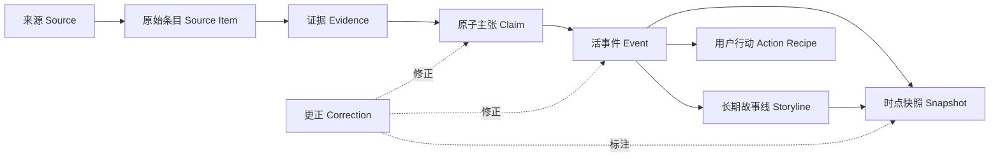

# AI 雷达网站设计书

版本：1.0  
状态：产品与体验基线  
工作名称：**震幅 AMPLITUDE · AI Radar**  
适用团队：产品、编辑、研究、设计、前端、后端、数据、增长与运营

---

## 1. 执行摘要

AI 雷达不是把每日 Markdown 搬到网页上的新闻站，而是一套持续更新、可验证、能把信息转化为行动的 AI 行业观测系统。

传统日报的问题不是信息不够，而是：

- 每天重置，昨天的重要事件失去后续。
- 同一事件被重复写成多篇文章，用户无法看清真实增量。
- 厂商宣传、媒体报道、独立验证和社区传闻混在一起。
- 只告诉用户“发生了什么”，不告诉用户“这对我有什么用”。
- 阅读结束后没有行动，也没有 7 天或 30 天后的结果验证。
- 用点击率和热度代替重要性，最终制造焦虑而非确定性。

AI 雷达必须连续回答五个问题：

1. AI 世界发生了什么真实变化？
2. 这与我当前的工作、学习或生活有什么关系？
3. 我应该相信到什么程度？
4. 我现在能做什么，成本、门槛和风险是什么？
5. 一周或一个月后，这件事究竟兑现了没有？

产品价值公式：

> **共享事实底座 × 个体相关性翻译 × 可执行行动 × 持续验证记忆**

产品定位语：

> **不是告诉你今天发生了什么，而是持续告诉你：AI 世界究竟改变了什么，以及你现在能做什么。**

---

## 2. 产品愿景与边界

### 2.1 愿景

让任何使用、学习或受到 AI 影响的人，都能以最少的时间获得可靠判断，并完成一个真实有用的下一步。

网站不以“让用户读更多”为成功，而以“让用户更早、更可靠地采取正确行动”为成功。

### 2.2 核心承诺

- **尽可能全：** 全量信号进入事件账本，低分影响展示层级，不被静默丢弃。
- **不会失忆：** 事件跨日持续更新，日报只是某个时点的不可变快照。
- **事实可追溯：** 关键判断可以回到原子主张、证据片段和原始来源。
- **重要性可解释：** 炸裂度、今日增量、可信度、热度和个人相关度分开计算。
- **对每个人有用：** 同一事实底座为不同角色翻译实际影响和行动，而不是制造不同事实。
- **持续验证：** 重点事件在 24 小时、7 天、30 天后回访。
- **允许纠错：** 不静默改写历史，公开保存修订原因、证据和影响范围。

### 2.3 非目标

第一阶段不做：

- 依靠情绪化标题和无限滚动的流量媒体。
- 普通评论区、争吵式社区或点赞热榜。
- 替代医疗、法律、金融等专业人士给出高风险结论。
- 按厂商划分的宣传目录。
- 只看社交热度的趋势榜。
- 为每个用户生成彼此矛盾的“个性化事实”。
- 复杂但无法行动的关系图和大屏仪表盘。

---

## 3. 三个设计命题

### 3.1 Visual thesis

**冷静的调查编辑部 × 实时科学仪器：暖白纸面、墨黑排版、单一信号红，一条由真实事件数据生成的行业震幅波贯穿页面。**

### 3.2 Content thesis

每个页面只负责回答一组明确问题：

- 此刻：最大的变化是什么？
- 为你：哪些变化与你有关？
- 事件：现在能够确定什么？
- 故事线：一个长期变化正在如何演进？
- 行动：你今天可以做什么？
- 证据：当前判断凭什么成立？
- 更正：我们之前哪里错了？

### 3.3 Interaction thesis

用户应感觉自己在读取一台活的行业仪器，而不是翻阅新闻卡片：

1. 进入时，24 小时行业震幅波一次性形成并静止。
2. 滚动到事件时，对应波峰聚焦并显示本次事实增量。
3. 切换“总冲击、时间、与我相关、立即可用”时，同一批事件平滑重排。
4. 新事件不抢走阅读位置，只提示“有新的变化等待查看”。

---

## 4. 产品原则

1. **实用优先于信息量。** 每条重点事件至少提供一个明确行动或“暂不行动”的理由。
2. **完整性与层级并存。** 全量账本负责不漏，首页负责判断先后。
3. **个性化解释，不个性化事实。** 所有人共享事件、证据、可信度和更正。
4. **主张先于摘要。** 摘要不能包含来源中不存在的事实。
5. **活事件先于文章。** 同一事件不因跨日或多家媒体报道而重复创建。
6. **今日增量先于重复热度。** 老事件只有出现新事实时才重新获得视觉权重。
7. **证据强度先于来源数量。** 12 家转载同一匿名消息仍然只有一个证据源。
8. **有限阅读先于无限消费。** 提供 3 分钟、10 分钟、深潜三档，并有明确结束状态。
9. **公开更正先于统一免责声明。** “AI 可能出错”不能替代逐条修订机制。
10. **用户目标先于职业标签。** 一个人可以同时是开发者、教师、创业者和普通消费者。
11. **显式反馈先于点击推断。** 点击可能是误触、反对或震惊，不能直接视为偏好。
12. **真实素材先于装饰图。** 优先使用论文图表、模型输出、芯片照片和产品界面。

---

## 5. 用户模型

### 5.1 不按职业锁死用户

用户画像由四个动态维度构成：

- AI 熟练度：不了解、会使用工具、会设计工作流、会开发与研究。
- 当前目标：了解、学习、创作、增效、决策、开发、采购、治理。
- 使用场景：个人、团队、企业、教育、研究、高风险专业领域。
- 风险偏好：尝鲜优先、稳定优先、隐私优先、合规优先。

职业、行业和工具栈可以多选，但“当前想完成的任务”拥有更高推荐权重。

### 5.2 首次使用只问三个问题

1. 你最近最想用 AI 完成什么？
2. 你主要从事哪些类型的工作？
3. 你更在意速度、成本、效果、隐私还是稳定性？

用户可以跳过设置，直接进入无个性化的公共雷达。

### 5.3 核心用户与必须交付的价值

| 用户群 | 主要问题 | 雷达必须交付的结果 |
|---|---|---|
| AI 开发者与工程师 | 模型、API、版本、价格和许可变化太快 | Release Diff、兼容性、最低可运行代码、成本、迁移和回滚风险 |
| 研究者与数据科学家 | 论文过多，贡献、宣传和复现状态混杂 | 贡献拆解、相近工作、代码/数据状态、复现条件、争议与后续验证 |
| 创业者与管理者 | 容易被热度带动，不知道落地窗口 | 能力边界、竞争地图、采用信号、成本变化、决策备忘录 |
| 产品经理 | 知道发布，却不知道能否变成功能 | 用户价值假设、适用/不适用边界、实验方案、依赖和上线检查表 |
| 运营人员 | 工具碎片化，演示成功但流程不稳定 | 可复用 SOP、人工复核节点、失败处理和节省时间估算 |
| 营销与内容人员 | 同质化、版权、事实错误、品牌不一致 | 内容工作流、案例、素材权利状态、品牌控制和效果验证 |
| 设计与创意人员 | 生成惊艳但控制力和一致性不足 | 可控性对比、原型流程、设计系统接入、资产许可和真实样例 |
| 教师与教育工作者 | 担心错误知识、作弊和隐私 | 课堂场景、评价方法、年龄适配、隐私与学术诚信边界 |
| 金融从业者 | 时效、可追溯和合规要求高 | 原始披露、数据时点、主张证据链、情景影响和使用边界 |
| 法律与合规人员 | 法域复杂，二手解读容易过时 | 法域、适用对象、生效日、原文条款、义务与产品数据风险 |
| 创作者与独立工作者 | 不知道买什么、如何低成本完成项目 | 按目标选工具、最低成本路径、模板、替代方案和订阅价值 |
| AI 新手 | 术语多、选择多、担心付费或操作错误 | 白话解释、五分钟安全体验、费用和隐私提醒、下一步学习路径 |
| 普通用户 | 新闻与生活无关，只留下焦虑或兴奋 | 对工作、学习、家庭、消费和隐私的直接影响与可选行动 |

高风险领域的“实用”不是直接给结论，而是帮助用户找到原始材料、准备问题、整理信息、识别风险，并知道何时必须交由专业人士处理。

### 5.4 通用 JTBD

> 当 AI 出现新能力、产品或风险时，我希望快速判断它是否与我有关、是否可信、是否值得现在行动，从而不错过机会，也不因炒作浪费时间和金钱。

---

## 6. 核心产品循环


### 6.1 发现

用户通过公共炸裂榜、自上次访问、个人雷达、故事线或搜索发现事件。

### 6.2 理解

系统按白话、实用、专家三层表达同一事实，并说明谁需要关心、谁可以忽略。

### 6.3 验证

用户查看主张、证据、来源独立性、厂商自报、反方证据和未知项。

### 6.4 行动

用户可以五分钟试用、完成三十分钟对照实验、安排半天原型，或明确选择继续观察。

### 6.5 跟踪

系统在 24 小时、7 天、30 天后回访：权重是否发布、产品是否可用、基准是否复现、价格是否落地、是否出现真实采用。

### 6.6 校准

用户反馈“有效、无效、节省时间、避免风险、判断错误”，系统同步校准建议与评分。

---

## 7. 顶层信息架构

### 7.1 主导航

- **此刻：** 全行业公共雷达。
- **为你：** 与当前目标和工具栈相关的价值流。
- **行动：** 今天可试用、采用、迁移、规避或学习的任务。
- **故事线：** 跨日、跨公司的长期变化。
- **全量：** 所有事件簇的可筛选账本。
- **搜索：** 事实检索、自然语言提问和保存查询。
- **关注：** 订阅、提醒、稍后验证和个人观察组合。

辅助入口：快照、更正、方法、信源覆盖、提交线索。

### 7.2 页面树

```text
/
├── radar                     此刻
├── for-you                   为你
├── actions                   行动中心
├── events                    全量事件账本
│   └── event/:slug           活事件案卷
├── stories
│   └── story/:slug           长期故事线
├── capabilities
│   └── capability/:slug      能力地图
├── search                    Ask Radar 与检索
├── watch                     关注与条件提醒
├── briefings
│   └── :date                 不可变日报/周报快照
├── entity/:type/:slug        公司、模型、工具、人物、政策
├── corrections               更正中心
└── methodology
    ├── scoring               评分方法
    └── coverage              信源覆盖与数据质量
```

---

## 8. 数据与内容模型

AI 雷达以现实世界对象为中心，不以文章为中心。



### 8.1 核心对象

| 对象 | 作用 | 关键字段 |
|---|---|---|
| Source | 稳定信源 | 类型、机构、官方性、语言、地区、抓取频率、健康状态 |
| SourceItem | 一篇文章、帖子、Release 或模型卡 | 原始/规范 URL、发布时间、发现时间、正文、哈希、归档 |
| Evidence | 支撑或反驳主张的证据片段 | 来源定位、摘录、截图、直接性、独立来源组、有效期 |
| Claim | 最小可核验事实 | 主体、动作、对象/数值、范围、时间、状态、置信度 |
| Entity | 公司、模型、产品、人物、论文、政策、芯片 | 名称、别名、类型、地区、关系、官方页面 |
| Event | 一个现实事件的稳定案卷 | 标题、动作、对象、版本、状态、实体、首次和最后更新 |
| EventUpdate | 事件的事实增量 | 新增/撤销主张、状态变化、今日增量、解释 |
| Storyline | 跨事件的长期问题 | 核心命题、当前判断、开放问题、指标和观察节点 |
| ScoreSnapshot | 某时点评分 | 各维度、规则版本、自动/人工来源、调整理由 |
| ActionRecipe | 针对任务和角色的行动 | 适合谁、步骤、耗时、费用、风险、证据、有效期 |
| BriefingSnapshot | 不可变快照 | 输入事件、排名、评分版本、截止时间、覆盖情况 |
| Correction | 修订记录 | 旧值、新值、原因、证据、严重性、时间、影响对象 |
| Watch | 用户订阅规则 | 目标、条件、阈值、频率、渠道、静默时间 |

### 8.2 必须保留的时间

- `occurred_at`：事件实际发生时间。
- `published_at`：来源发布时间。
- `discovered_at`：雷达首次发现时间。
- `verified_at`：关键事实获得验证时间。
- `updated_at`：事件案卷最后变化时间。

这是避免“仓库更新被误写成首发”和“旧闻重新上榜”的基础。

### 8.3 状态机

```text
主张：未核实 → 媒体报道 → 官方自报 → 已确认 → 独立验证
                       ↘ 有争议 → 被反驳 / 被撤回

事件：信号 → 传闻 → 可靠报道 → 官宣 → 可用 → 独立实测 → 规模采用
                                        ↘ 受限 / 延期 / 撤回

故事线：萌芽 → 活跃 → 加速 / 转向 → 降温 → 休眠 / 已解决
```

---

## 9. 评分与可信度系统

### 9.1 五个独立指标

| 指标 | 回答的问题 | 展示方式 |
|---|---|---|
| 总冲击 Impact | 这件事长期可能改变多少？ | 0–100，公共统一 |
| 今日增量 Delta | 今天究竟新增了多少事实？ | 0–100，显示与上一版差异 |
| 可信度 Confidence | 核心主张获得何种证据支持？ | 0–100 + A–E |
| 传播动量 Momentum | 讨论和采用是否正在扩散？ | 趋势，不冒充事实增量 |
| 与我相关 Relevance | 对用户当前目标有多大影响？ | 0–100，可解释个性化 |

行动价值 Actionability 作为状态表达：`现在可用 / 适合测试 / 需要准备 / 继续观察 / 应规避`，避免页面堆满数字。

### 9.2 总冲击

- 能力边界：0–20
- 影响人群和行业范围：0–15
- 经济与成本结构：0–15
- 生态和竞争格局：0–15
- 安全、监管和战略外溢：0–15
- 持久性与不可逆性：0–10
- 意外程度：0–10

### 9.3 今日增量

- 事件状态跃迁：0–30
- 新事实的信息量：0–25
- 是否改变用户决策：0–20
- 时效性：0–15
- 是否纠正或推翻既有判断：0–10

### 9.4 可信度

- 证据真实性与直接性：0–30
- 可下载、可复现、可验证程度：0–20
- 独立来源交叉印证：0–20
- 来源历史可靠性：0–15
- 完整性和时间一致性：0–15
- 存在矛盾时额外扣 0–30

等级：A 85–100、B 70–84、C 50–69、D 30–49、E 0–29。

### 9.5 反炒作指标

```text
炒作差 = 传播动量 - 今日事实增量
```

炒作差过高时显示：

> 讨论热度快速上涨，但过去 24 小时没有出现足以改变判断的新事实。

### 9.6 排序

公共全量榜严格按总冲击排序，同分看今日增量与可信度。

首页波峰排序：

```text
45% 总冲击 + 30% 今日增量 + 15% 传播动量 + 10% 紧迫性
```

“为你”排序：

```text
30% 个人相关度 + 25% 行动价值 + 20% 总冲击
+ 15% 今日增量 + 10% 紧迫性
```

低可信内容不能因热度进入正式主榜，只能进入独立未确认雷达。

### 9.7 主张账本

| 主张 | 状态 | 当前判断 | 下一验证条件 |
|---|---|---|---|
| 权重可下载 | 已确认 | 成立 | 检查许可证和文件完整性 |
| 完整系统开源 | 被反驳 | 不成立 | 两个关键模块仅提供 API |
| 性能超过竞品 | 官方自报 | 尚未独立复现 | 等待同条件第三方测试 |
| 消费级显卡可运行 | 有争议 | 取决于量化配置 | 等待显存和速度实测 |

事件可信度不能被大量无争议背景主张稀释；核心结论中最弱证据必须影响总等级。

---

## 10. 核心功能系统

### 10.1 自你上次离开后

默认回答：

- 新出现了什么？
- 哪些传闻获得确认或被否认？
- 哪些厂商主张获得独立复现？
- 哪些事件炸裂度或可信度变化？
- 哪些热门话题正在降温？
- 哪些行动建议已经失效？

时间锚点可由用户修改，登录不是使用前提。

### 10.2 三档阅读预算

- **3 分钟：** Top 5、与你最相关的三项变化、一个今日行动。
- **10 分钟：** Top 10、故事线增量、重要快讯、传闻和更正。
- **深潜：** 主张、证据、时间线、原始材料、复现和完整账本。

页面提供明确终点，例如“你已覆盖今天 92% 的高冲击变化”。

### 10.3 行动配方

行动类型：

- 现在试用
- 建立小规模测试
- 迁移或替换
- 更新依赖、安全或合规设置
- 为即将到来的变化做准备
- 继续观察
- 可以忽略

每个行动必须包含：

- 适合谁以及不适合谁
- 预期收益
- 最多三步的执行方法
- 5 分钟、30 分钟或半天的投入档位
- 费用、账号、地区、硬件与技能前置条件
- 数据、版权、安全与合规风险
- 成功标准、停止条件、替代方案和回滚方法
- 建议有效期及支撑证据
- 什么情况会让建议失效

不可逆或高风险建议只能由高可信证据触发；证据不足时只能建议观察或验证。

### 10.4 能力地图

用户先从“能做什么”出发，再看到厂商：

- 实时语音交互
- 长视频理解
- 本地文档问答
- 代码代理
- 深度研究与检索
- 一致性图像/视频生成
- 流程自动化
- 数据分析与可视化

每个能力节点关联模型、产品、开放程度、成熟度、成本、地区、案例、近期变化和行动配方。

### 10.5 Ask Radar

自然语言回答必须：

- 引用具体主张和原始证据。
- 显示知识截止时间。
- 区分已知、不确定和未知。
- 展示与结论冲突的最强证据。
- 支持切换白话、实用和专家解释。
- 支持“截至某历史时点”的回答。
- 不把个性化建议伪装成客观事实。

### 10.6 个人观察组合

用户可以关注公司、模型、能力、行业、政策地区、自己的工具栈和自然语言问题。

首页始终保留一层全行业公共现实；个性化流中建议保留至少 15% 的相邻领域与低曝光高影响内容，避免信息茧房。

### 10.7 结构化社区贡献

第一阶段不开放普通评论，仅允许：

- 补充一手来源
- 提交第三方实测或复现
- 提供反对证据
- 挑战评分并说明理由
- 报告行动有效或无效
- 提交遗漏和更正

贡献进入审核流程，通过后进入证据图并署名。

---

## 11. 页面规格

### 11.1 此刻 `/radar`

首屏必须在十秒内回答：最大的变化是什么、行业今天有多剧烈、用户应该先做什么。

模块顺序：

1. 数据截止时间、覆盖源数、事件簇数、待核实数和抓取健康度。
2. “自你上次离开后”变化摘要。
3. 今日一句话判断、总震幅、24 小时震幅波和唯一头条。
4. Top 5 主峰，可切换按总冲击、时间、与我相关、立即可用。
5. 今日行动：最多三个真正可完成的任务。
6. 炸裂榜第 6–10 名，中等密度连续排版。
7. 正在发展的 3–5 条故事线及今日新增节点。
8. 获得确认、被推翻、正在降温和出现更正的事件。
9. 全量事件账本。
10. 与事实区物理隔离的未确认雷达。
11. 接下来 24 小时观察点和今日更正。

桌面线框：

```text
┌──────────────────────────────────────────────────────────────────────┐
│ 震幅 AMPLITUDE     此刻 为你 行动 故事 全量 搜索        截止 08:30 │
├──────────────────────────────────────────────────────────────────────┤
│ 今天，AI 改变了多少？                                                │
│                                                                      │
│ 96 / 100     Claude 推进长期数学边界                                 │
│              一句话影响判断                       [3 分钟播报]       │
│ ─────╱╲──────╱╲────────────╱╲──────────────────────────              │
│     01       02            03                                        │
├───────────────────────────────────────────────┬──────────────────────┤
│ 01 事件标题                     96  今日 +92 A │ 证据检查器           │
│    为什么重要 · 对谁有影响 · 立即行动          │ 当前主张 / 原始来源   │
│ ───────────────────────────────────────────── │ 独立验证 / 未知项     │
│ 02 事件标题                     93  今日 +88 B │                      │
│ 03 ...                                        │                      │
├───────────────────────────────────────────────┴──────────────────────┤
│ 相比上次访问 · 故事线 · 全量账本 · 未确认雷达 · 今日更正             │
└──────────────────────────────────────────────────────────────────────┘
```

### 11.2 为你 `/for-you`

- 个性化“自上次访问”。
- 与职业、当前任务和工具栈相关的事件。
- 今日行动队列。
- 用户正在使用的工具发生的价格、许可、安全和能力变化。
- 已保存事件的 24 小时、7 天、30 天回访。
- “为什么推荐给我”以及即时调整入口。
- 一键切回无个性化公共雷达。

### 11.3 行动中心 `/actions`

行动中心按目标而非新闻分类：

- 今天可以试
- 值得做对照实验
- 应当迁移或更新
- 需要降低风险
- 准备即将发生的变化
- 目前可以忽略

支持按角色、投入时间、费用、编程门槛、隐私要求、地区和工具过滤。

行动详情必须展示预期产物，而不是只展示教程步骤；完成后请求结构化反馈，并安排复查。

### 11.4 活事件案卷 `/event/:slug`

- 当前能够确定的一句话。
- 普通用户能理解的白话解释。
- 总冲击、今日增量、可信度、传播动量、炒作差。
- 本次更新究竟改变了什么。
- 谁需要关心，谁可以忽略。
- 面向角色的行动配方。
- 生命周期时间线。
- 主张与证据账本。
- 来源独立性和转载链。
- 最强支持解释、最强质疑和未知项。
- 什么会改变本站判断。
- 24 小时、7 天、30 天回访状态。
- 关联故事线、实体和替代方案。
- 更新、更正和评分调整记录。
- 关注、分享当前快照、导出 Markdown。

### 11.5 故事线 `/story/:slug`

故事线必须是可被验证的问题，而不是宽泛标签，例如：

- 开放权重模型是否正在缩小 Agent 能力差距？
- 云厂商自研芯片是否开始降低 NVIDIA 依赖？

页面包含：

- 当前判断和置信度。
- 今日新增了什么。
- 关键指标和趋势。
- 事件时间轴及因果、竞争响应和反证关系。
- 支持和反对当前判断的最强证据。
- 尚未回答的问题。
- 下一个关键观察节点。
- 7 天、30 天、90 天变化。
- 历史判断是否应验。
- 订阅故事线。

### 11.6 全量账本 `/events`

- 紧凑流和数据表两种视图。
- 发生时间与发现时间切换。
- 按总冲击、增量、可信度、动量、相关度和时间排序。
- 类别、实体、地区、来源类型、事件状态、开放权重、API、价格、地区可用性过滤。
- 保留低分事件、旧闻补录和潜在重复。
- 分页或继续读取，不使用无限滚动。
- 导出 Markdown、JSON、CSV 或自定义 RSS。

### 11.7 搜索 `/search`

支持关键词、语义与实体图谱混合搜索：

- 最近一个月有哪些真正开放权重、可商用的视频模型？
- Claude 最近一次价格变化是什么？
- 哪些厂商 benchmark 已有独立复现？
- 适合教师整理作业反馈且不上传学生隐私的方案有哪些？

结果按直接答案、事件、主张、故事线、能力、实体、行动和原始证据分组。

### 11.8 关注 `/watch`

用户可订阅公司、模型、人物、工具、事件、故事线、关键词、自然语言查询或主张状态变化。

条件示例：

```text
当我使用的 AI 工具发生安全事件时立即提醒
当开放权重模型总冲击 ≥ 75 且可本地运行时提醒
当某厂商性能主张获得独立复现时提醒
当 API 价格变化超过 20% 时提醒
当一条传闻获得官方确认或被推翻时提醒
```

通知必须说明“相较上一次具体改变了什么”，支持立即、每日合并、每周回顾、仅重大变化、静默时段和冷却时间。

### 11.9 快照 `/briefings/:date`

快照一旦生成不可静默改写，保存：

- 截止时间和覆盖窗口。
- 输入事件及证据 ID。
- 当时排名、评分和规则版本。
- 用户画像版本。
- 信源覆盖和抓取失败。
- Markdown、RSS、邮件版本和内容哈希。

错误通过更正注释处理，并链接活事件的当前结论。支持按当时所知和按当前事实两种查看方式。

### 11.10 更正 `/corrections`

每条更正公开展示：

- 原内容和新内容。
- 修改原因和新证据。
- 严重性。
- 受影响事件、故事线、快照和行动建议。
- 是否向订阅者发送撤回通知。

### 11.11 方法与覆盖 `/methodology`

- 信源分级与覆盖范围。
- 抓取健康和已知盲区。
- 评分公式和人工调整规则。
- AI 与人工各自负责什么。
- 更正政策、利益冲突和商业合作披露。
- 重大事件召回率、首次发现延迟、重复率和一手来源占比。

---

## 12. 关键用户流程

### 12.1 新用户五分钟首次价值

```text
进入公共雷达
→ 看懂今日 Top 3
→ 选择“我想提高工作效率”
→ 获得一条与其任务相关的行动
→ 完成五分钟安全试用
→ 标记有效/无效
→ 可选保存目标与提醒
```

注册只在跨设备同步、收藏或提醒时提出。

### 12.2 开发者选型

```text
看到模型发布
→ 查看 Release Diff、价格、许可和独立实测
→ 运行最小代码与自己的测试样本
→ 比较现有方案
→ 保存迁移/不迁移决定
→ 7 天后复查性能、稳定性和成本
```

### 12.3 非技术工作者增效

```text
输入“我想自动整理访谈”
→ 按隐私、预算、语言得到能力与方案
→ 选择 30 分钟行动配方
→ 上传脱敏样本或使用示例材料
→ 得到可复用 SOP
→ 记录节省时间和失败点
```

### 12.4 普通用户理解风险

```text
看到高热度事件
→ 阅读一句白话结论
→ 查看它是否影响工作、家庭、消费或隐私
→ 区分确认事实与传闻
→ 选择忽略、学习、试用或设置提醒
```

---

## 13. 个性化与反信息茧房

### 13.1 个性化只影响

- 排序
- 解释方式
- 展开深度
- 行动建议

它不得改变原始事件、主张、证据、公共炸裂榜和更正。

### 13.2 公共现实层

首页始终展示全行业最重要事件，即使与用户历史兴趣不符。“为你”建议由四部分组成：

- 直接相关信号
- 全行业公共重要事件
- 相邻领域机会
- 反方证据与低曝光高影响信号

### 13.3 多样性预算

推荐系统约束：厂商集中度、地区、开源/闭源、官方/媒体/研究/社区、热门/低曝光和支持/质疑证据分布。

同一厂商的多个更新优先聚为一个事件簇，避免占领整页。

### 13.4 用户控制

每条推荐可以查看：

- 因为什么目标、工具或关注项出现。
- 哪些因素影响排序。
- 如何降低、关闭或只保留重大变化。

提供无个性化视图、重置画像和显式反馈。

---

## 14. 视觉设计系统

### 14.1 色彩

```css
--paper: #F4F1EA;
--paper-raised: #FBF9F4;
--ink: #161616;
--ink-secondary: #585752;
--ink-muted: #77746D;
--rule: #D3CEC2;
--rule-strong: #9B978D;
--signal: #C42632;
--signal-soft: rgba(196, 38, 50, 0.10);
```

信号红只用于当前焦点、重大增量、关键波峰和主要操作，单屏面积控制在约 8% 以下。状态必须同时使用文字、符号或线型，不能只依赖颜色。

传闻使用虚线、低对比和明确文字；已确认使用实线和“已确认”，不新增黄绿状态色。

### 14.2 字体

```css
--font-editorial: "Songti SC", "STSong", "Noto Serif CJK SC", serif;
--font-ui: -apple-system, BlinkMacSystemFont, "Segoe UI",
           "PingFang SC", "Microsoft YaHei", sans-serif;
--font-data: "IBM Plex Mono", "SFMono-Regular", monospace;
```

- 品牌和头条使用编辑型宋体。
- 正文和操作使用系统黑体。
- 时间、版本、分数和来源编号使用等宽体。
- 今日核心标题：`clamp(2.25rem, 5vw, 5.5rem)`。
- 正文：桌面 17–18px，移动 16–17px，行高约 1.7。
- 数据和注释不得低于 13px。
- 中文正文每行约 32–42 个汉字。

### 14.3 网格与构图

- 桌面最大内容宽约 1320px，12 栏、24px 栏距。
- 主阅读区 7–8 栏，证据检查器 3–4 栏。
- 平板 8 栏；手机 4 栏、单列内容。
- 视觉层级依赖字号、字重、对齐、留白和 1px 规则线。
- 普通内容不使用圆角和阴影容器。
- 只有表单、弹层和确实作为交互对象的模块可以使用 2–4px 小圆角。
- 首屏只允许一个主视觉：真实证据画面或数据震幅波。

### 14.4 组件语法

避免通用 Card，建立语义组件：

- `SignalBand`：全宽态势带。
- `EventLead`：唯一头条版式。
- `ShockWave`：真实数据震幅波。
- `EventRow`：连续事件行。
- `ImpactScore`：分数、变化量和解释入口。
- `EvidenceInspector`：证据检查器。
- `ClaimLedger`：主张账本。
- `StoryRail`：长期故事线轨道。
- `RoleActionLine`：角色行动建议。
- `ReadingBudgetSwitch`：阅读预算。
- `NoiseBand`：未确认信号区。
- `CorrectionStrip`：更正区。
- `SourceHealth`：覆盖和抓取状态。

标签使用小号文字、括号、下划线或短竖线，不使用彩色胶囊海洋。

### 14.5 图表

- 默认 SVG，最多使用信号红、黑和灰阶。
- 多序列依靠实线、虚线、点线、线宽和纹理区分。
- 震幅波由真实事件数据生成，不作为装饰。
- 每个图提供自然语言摘要和可切换数据表。
- 不使用彩色甜甜圈、3D 图、无刻度面积图和复杂力导向图作为默认视图。

---

## 15. 交互与动效

### 15.1 动效语言

```css
--motion-fast: 120ms;
--motion-standard: 240ms;
--motion-emphasis: 480ms;
```

- 首页波形在 600–900ms 内绘制一次后静止。
- 排序切换在 180–260ms 内共享布局重排。
- 事件原位展开在 200–280ms 内完成，标题位置保持稳定。
- 分数只在真实更新时短暂强调。
- 故事线新增节点沿时间轴出现，说明哪里发生变化。

禁止循环呼吸、闪烁、自动滚动、鼠标背景视差、普通按钮弹跳和虚假滚动计数。

`prefers-reduced-motion` 下关闭绘制和位移动画，仅保留即时状态切换。

### 15.2 阅读行为

- 默认展示结论，按需展开证据。
- 筛选和排序保留当前位置。
- 实时更新显示“有 N 条新变化”，由用户主动载入。
- 事件展开状态写入 URL，可分享和恢复。
- 最后阅读位置使用细线标记。
- 悬停功能必须有触摸和键盘等价操作。

### 15.3 键盘效率

- `/`：搜索。
- `J / K`：上一条/下一条事件。
- `Enter`：展开。
- `S`：收藏。
- `1 / 2 / 3`：切换阅读预算。
- `O`：打开原始来源。

快捷键需可发现，在输入框内自动停用。

---

## 16. 响应式设计

断点建议：小屏 `<480px`、手机 `480–767px`、平板 `768–1023px`、桌面 `1024–1439px`、宽屏 `≥1440px`。

### 16.1 手机

- 首屏仅保留日期、今日判断、Top 1 和短震幅线。
- 三栏布局变为单列，不直接缩小桌面。
- 震幅轴收至左侧，成为贯穿页面的信号阅读轨。
- 事件行显示序号、标题、核心分数和一句影响；证据原位展开。
- 来源可使用底部面板，但重要证据仍存在于页面 HTML。
- 顶部操作仅保留今天、筛选、播报。
- 固定底栏仅保留此刻、行动、搜索、我的。
- 主张账本由表格变成定义列表。
- 触摸目标至少 44×44px。
- 横向滑动不能成为唯一导航方式。

### 16.2 平板与桌面

- 平板正文 5 栏、辅助轨道 3 栏。
- 桌面采用“一条主轴 + 一个证据检查器”。
- 证据检查器可粘性滚动，到章节末尾停止。
- 宽屏增加页边，不无限拉宽正文。
- 320px 宽和 200% 缩放下，非数据表不得出现横向滚动。

---

## 17. 可访问性

最低目标 WCAG 2.2 AA：

- 正文对比度不低于 4.5:1，大字不低于 3:1。
- 清晰焦点轮廓，且不被粘性导航遮挡。
- 使用正确的 `header`、`nav`、`main`、`article`、`section`、`aside` 和标题层级。
- 炸裂榜使用有序列表语义。
- 图表提供文字摘要、数据表和非颜色状态说明。
- 实时更新使用克制的 `aria-live="polite"`。
- 分数读出完整含义，例如“总冲击九十四，今日增量八十八，可信度 A”。
- 弹层支持焦点锁定、Esc 关闭和焦点恢复。
- 视频和音频不自动播放，提供字幕、文字稿和速度控制。
- 支持文字放大、强制颜色和减少动态效果。
- 定期使用键盘、VoiceOver、NVDA 和真实移动设备测试。

---

## 18. 内容生产与编辑后台

后台不是富文本 CMS，而是事件、主张和证据工作台。

### 18.1 后台界面

1. **覆盖控制台：** 各信源最后成功时间、今日产量、异常下降、重复率和失败原因。
2. **聚类工作台：** 合并、拆分、关联旧事件、标记可能重复。
3. **主张与证据台：** 每句摘要必须有证据指针。
4. **评分工作台：** 分项得分、规则版本、人工覆盖理由和审计记录。
5. **故事线编辑器：** 把事件挂入长期问题，更新判断和观察点。
6. **行动编辑器：** 校验适用用户、步骤、成本、风险、有效期和证据。
7. **发布台：** 同屏预览 3 分钟、10 分钟、深潜、移动、RSS 和 Markdown。
8. **更正中心：** 一次更正同步事件、故事线、快照、RSS 和订阅。
9. **来源健康：** RSS 失效、页面结构变化、API 配额、反爬和异常零产出。

### 18.2 编辑状态

```text
已抓取 → 已解析 → 待聚类 → 待核验 → 待编辑
→ 可发布 → 已发布 → 待回访 → 已更新 / 已更正 / 已归档
```

只有匿名来源、单一二手来源、未复现厂商性能主张，或涉及医疗、法律、金融、安全和重大指控的内容，不得自动标记为“已确认”。

### 18.3 自动化流水线

```text
RSS / API / GitHub / 官方博客 / 研究平台
→ 抓取与证据快照
→ 正文解析、语言和时间标准化
→ 实体识别、近重复检测、事件聚类
→ 原子主张提取和证据对齐
→ 冲突检测、多维评分
→ 角色影响和行动草拟
→ 规则质检与人工复核
→ 活事件增量发布
→ 每日快照：Markdown / RSS / 邮件
→ 24 小时、7 天、30 天回访
```

网站全天增量更新；每日 08:30 只是固定截止时间的可引用快照。Markdown 是稳定发布与归档产物，结构化数据库是事实源。

---

## 19. 技术架构建议

### 19.1 前端

- TypeScript 与支持 SSR/ISR 的 React 框架。
- CSS Variables 管理设计令牌。
- 使用无样式、可访问的 Headless 组件，不套用卡片型 UI 主题。
- 公共页面服务端渲染，个性化在基础 HTML 上渐进增强。
- 实时增量优先 SSE，只有双向协作才使用 WebSocket。
- JavaScript 失败时仍可阅读核心内容和来源。

### 19.2 数据与处理

- PostgreSQL 作为事件、主张、证据、版本和用户配置的事实源。
- `pgvector` 支持 MVP 的近重复检测和聚类候选。
- PostgreSQL 全文检索支撑早期搜索，规模增长后再引入独立搜索服务。
- 消息队列承载抓取、解析、回访和发布任务。
- 对象存储保存证据快照、图片和生成的分享图。
- Markdown 同步至 Git 与对象存储，便于审计和迁移。
- LLM 经统一适配层调用，保存模型、提示词、规则和结构化输出版本。
- 聚类、评分和摘要必须可重新运行，不能成为不可追溯文本。

### 19.3 安全

- 抓取器阻止内网、环回和云元数据地址，防范 SSRF。
- 限制响应体、类型、跳转和下载时间。
- 抓取内容视为不可信输入，清除脚本、隐藏文本和恶意指令。
- 网页提示注入不得让模型调用工具或修改数据。
- 后台采用 RBAC；评分覆盖、合并、删除和更正进入不可变审计日志。
- 密钥进入专用密钥管理；管理员使用强认证。
- 证据摘录遵守版权和访问条款，不公开整篇受保护内容。

### 19.4 性能预算

- LCP p75 目标 ≤2.0 秒，最差不超过 2.5 秒。
- INP p75 目标 ≤150ms，至少保持在 200ms 内。
- CLS ≤0.05。
- 首屏关键 JavaScript gzip 后约 120KB 内。
- 关键 CSS 约 25KB 内。
- 默认首页总传输量 1MB 内。
- 首屏不加载视频、完整关系图和全量长列表。
- 波形服务端生成轻量 SVG，不引入大型图表库。
- 中文正文不下载完整 WebFont。
- 静态快照和事件页使用 CDN 与增量再生成，个性化独立加载。

### 19.5 SEO 与分发

- 事件页是长期事实页面，日报只保留当日判断，避免关键词互相竞争。
- 每页提供 canonical、发布时间、最后修改、编辑、来源和更正记录。
- 使用合适的 `NewsArticle`、`Article`、`ItemList`、`BreadcrumbList` 结构化数据。
- 筛选、排序和个性化 URL 默认 `noindex`。
- 按日期、事件和故事线拆分 Sitemap。
- 输出 RSS/Atom、Markdown、邮件和 Open Graph 图。
- 重要证据不能只存在于客户端弹层。
- 长期 SEO 资产是事件生命周期、承诺兑现率和基准复现史，而非重复新闻。

---

## 20. 隐私、普惠与高风险边界

- 阅读匿名，账户可选。
- 角色、目标和本地排序优先保存在浏览器。
- 只有跨设备同步、收藏和提醒时请求账户。
- 不使用第三方广告追踪，不建立跨站画像。
- 收藏的公司、行业和查询属于敏感兴趣数据，应加密存储。
- 提供导出、删除账户、关闭个性化和清除历史。
- 用户输入发送给外部模型前做敏感信息检测和脱敏。
- 明确披露模型供应商、保存期限和用途。
- 个性化不能改变事实和全站统一可信度。
- 医疗、法律、金融等行动配方只辅助整理、核验、准备问题和识别风险，明确提示专业人士介入条件。

---

## 21. 商业模式原则

为了让任何用户都能受益，核心事实、来源、更正和公共炸裂榜不应被付费墙阻挡。

可选付费价值：

- 高级条件提醒和私人 RSS/Webhook。
- 个人工具栈、行业和项目的深度影响分析。
- 团队共享雷达、任务分派和决策备忘录。
- 可重复验证的工作流模板与迁移清单。
- 专业数据导出、API 和历史数据集。
- 企业信源、合规地区和内部知识集成。

商业合作必须披露，不得影响公共评分、可信度或更正。

---

## 22. 成功指标

### 22.1 北极星指标：每周验证有效行动率

> 每周活跃用户中，因为雷达中的某条信号完成至少一个行动，并确认该行动帮助其节省时间、改善结果、降低成本、避免风险或获得有效学习的人数占比。

点击、阅读时长、收藏本身不算有效行动。

有效行动包括：

- 完成一次真实试用或对照实验。
- 做出采用或不采用的决定。
- 将工作流投入使用。
- 取消无价值订阅或避免错误采购。
- 修复安全或合规问题。
- 形成可复用的研究、教学或创作材料。
- 在回访中确认当时判断正确。

### 22.2 价值指标

- 首次价值时间。
- 行动开始、完成和有效率。
- 节省时间、费用或避免损失。
- 工作流 7 日复用率。
- 关注事件获得有效后续的比例。

### 22.3 信息质量

- 重大事件召回率。
- 一手来源覆盖率。
- 主张级证据覆盖率。
- 首次发现与首次核验延迟 P50/P95。
- 重复事件、错误合并和错误拆分率。
- 无证据主张率和更正速度。
- 厂商自报与独立验证区分率。
- 可信度和炸裂度的事后校准度。

### 22.4 普惠性

分别统计开发者、知识工作者、新手和普通用户的首次价值时间、有效行动率、理解率、不相关率和 7 日回访率。任一核心群体长期显著低于整体，说明产品正在退化为小圈层工具。

### 22.5 反成瘾护栏

不把以下指标作为核心优化目标：

- 无限增加停留时间。
- 阅读条数和连续签到。
- 推送打开率最大化。
- 情绪化标题点击率。

理想结果是用户用更短时间获得更高确定性，并安心离开。

---

## 23. 分阶段路线图

### 阶段 0：产品与数据地基

- 事件、主张、证据、故事线和行动的数据契约。
- 炸裂度、增量和可信度定义。
- 设计令牌和此刻、事件、行动三类原型。
- 固定 Markdown 工作流和 20–30 个核心信源试跑。
- 版权、引用和更正规则。

通过条件：任何摘要句可指向证据，团队能区分新事件与旧事件新增节点，移动原型能在 30 秒内传达 Top 3。

### 阶段 1：公共雷达 MVP

- 此刻首页和全量炸裂榜。
- 活事件案卷。
- 3/10/深潜阅读预算。
- 基础搜索、日期快照、Markdown、RSS 和邮件。
- 最小运营后台、来源健康和更正记录。

暂缓复杂关系图、评论、多语言、公共 API 和高度个性化。

### 阶段 2：不会失忆

- 活事件生命周期和故事线。
- 自上次访问。
- 24 小时、7 天、30 天回访。
- 传闻转确认、独立复现、推翻与更正提醒。
- 角色、工具栈、收藏和条件提醒。

### 阶段 3：从知道到行动

- 行动中心和真实试用流程。
- 开发、内容、设计、教育、办公等角色配方。
- 模型价格、许可证、能力与独立复现对比。
- 自然语言档案检索。
- 工作流模板、迁移和风险清单。

### 阶段 4：平台化

- 多语言和地区化政策。
- 公共查询 API、Webhook 和可嵌入组件。
- 企业团队共享雷达。
- 专家证据贡献。
- 厂商承诺兑现率、基准复现率和历史校准数据集。

平台化前提是已形成可信数据资产，而不是只有流量。

---

## 24. 上线验收标准

### 产品价值

- 新用户 30 秒内能说出今天最重要的三件事。
- 三分钟模式有明确结束状态。
- 每个重点事件至少有一个行动或明确的“不行动”理由。
- 用户无需注册即可获得核心价值。
- 专业用户可以展开原始证据，新手无需理解模型架构也能安全尝试。

### 信息质量

- 每个关键主张都能定位到证据。
- 官方表述、独立验证、媒体报道和传闻无需颜色即可区分。
- 厂商 benchmark 明确标注自报。
- “开放权重”和“开源”不会混用。
- 重复报道聚为同一事件，旧闻更新不会写成首发。
- 更正能同步事件、故事线、快照、RSS 和提醒。

### 视觉与交互

- 首页移除阴影和圆角后层级仍然成立。
- 首屏只有一个主视觉和一个主要操作。
- 总冲击、今日增量、热度、可信度不会视觉混淆。
- 实时更新不打断当前阅读。
- 320px 宽、200% 缩放、键盘和屏幕阅读器可用。
- JavaScript 失败时仍可阅读核心内容和来源。

### 运营与工程

- 自动化失败有告警和人工补救。
- 任务幂等，重复执行不产生重复事件。
- 无证据指针的摘要无法发布。
- 人工覆盖评分必须填写理由。
- 证据、模型、提示词、评分规则和快照均有版本。

---

## 25. 待决策问题

1. 正式品牌使用“震幅”“AI Radar”还是双品牌？
2. 公共首页是否默认 24 小时滚动窗口，日报快照是否固定 08:30？
3. 总冲击评分由编辑模型、人工委员会还是混合机制最终负责？
4. 行动配方是否允许用户直接在站内运行，还是先跳转第三方工具？
5. 哪些证据允许长期内部归档，哪些只能保存哈希和必要摘录？
6. 第一批重点职业是开发、内容、产品、教育，还是更宽但较浅地覆盖？
7. 高风险专业领域是否需要独立审核人与免责声明模板？
8. 个性化默认本地存储还是匿名账户？
9. 是否提供公开评分 API，如何防止被厂商当作营销素材滥用？
10. 团队是否有能力持续完成 24 小时、7 天和 30 天回访？

---

## 26. 最终判断标准

网站不应让用户离开时觉得“我今天看了很多 AI 新闻”，而应让用户明确感受到：

> **我知道 AI 世界今天真正改变了什么，这些变化与我有什么关系，我能相信哪些部分，以及我接下来能做什么。**

唯一值得长期优化的问题是：

> **用户是否因为 AI 雷达而少浪费了一些时间、金钱和注意力，并完成了一个真正有用的行动？**

